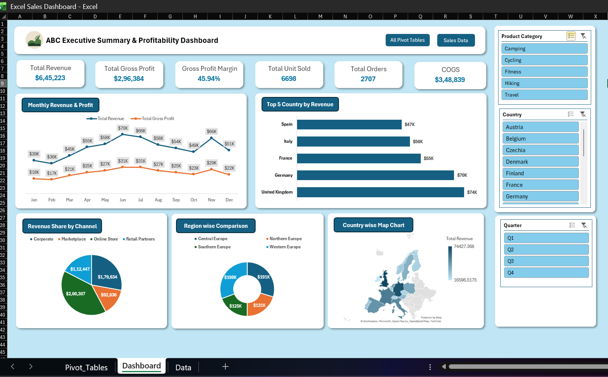

# ABC Executive Summary & Profitability Dashboard (Excel)

## Summary
An interactive Excel dashboard that gives management a quick view of sales and profitability. It analyzes 2,707 orders from 2026 across 4 European regions, 5 product categories and 4 sales channels. It tracks revenue, gross profit, margin, units sold, orders and COGS, with slicers to filter by Product Category, Country and Quarter.

## Key Insights
- Total revenue was **$6.45L** with a gross profit margin of **45.94%**.
- Revenue peaked in **June (~$70K)**.
- The **United Kingdom** and **Germany** are the top countries by revenue.
- The **Online Store** is the largest sales channel (~$2.6L), followed by Corporate.
- **Western Europe** is the highest-earning region.

## Tools & Techniques
- Pivot Tables and Pivot Charts
- Slicers for interactive filtering
- Line, bar, pie, donut and map charts
- KPI cards linked to pivot data
- Data sheet with calculated columns (Revenue, COGS, Gross Profit, Gross Margin %)

## Files
- `Excel_Sales_Dashboard.xlsx`: the full workbook (Data, Pivot_Tables, Dashboard)
- `Sales_Dashboard.png`: dashboard screenshot

> Note: The dataset is sample data used for practice.
