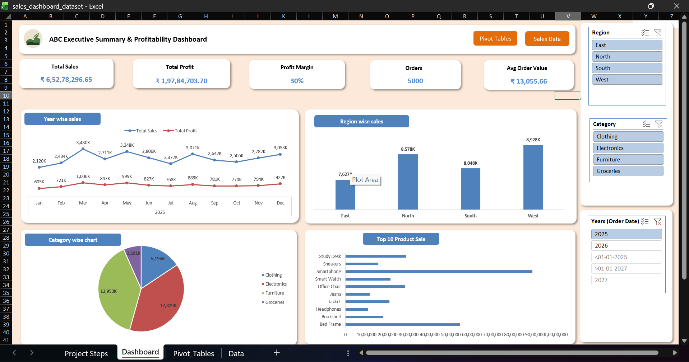

# Sales Data Analysis using Excel Formulas

## Summary
An Excel analysis workbook built on 5,000 sales orders (2025-2026) across 4 regions, 4 product categories and 16 products. Instead of pivot tables, it uses formulas to calculate sales, find product totals and flag low-profit orders. It also includes a lookup tool where you pick a product or enter an Order ID to get its details.

## What it does
- **Sales by Region and Category:** a grid built with SUMIFS that shows total sales for every region and category combination.
- **Product Total Sales:** a totals table built with SUMIFS, plus a dropdown lookup using XLOOKUP and INDEX-MATCH.
- **Order Lookup:** enter an Order ID to get that order's details.
- **Low-Margin Alerts:** conditional formatting highlights orders with a profit margin below 10% and above 40%.

## How the data is calculated
- Sales = Quantity x Unit Price x (1 - Discount %)
- Cost = Quantity x Unit Cost
- Profit = Sales - Cost
- Profit Margin % = Profit / Sales

## Key Insights
- Clothing has the highest profit margin (about 47%), and Groceries the lowest (about 16%).
- (Add 1-2 insights from your own SUMIFS grid, e.g. the top region and category.)

## Tools & Techniques
- SUMIFS with multiple conditions and absolute references
- XLOOKUP and INDEX-MATCH
- Data Validation dropdowns
- Conditional Formatting with custom formulas
- Excel Tables

## Files
- `sales_dashboard_dataset.xlsx`: the workbook (Sales Data, Analysis)
- `Analysis.png`: screenshot of the Analysis sheet

> Note: The dataset is fictional and created for practice.
