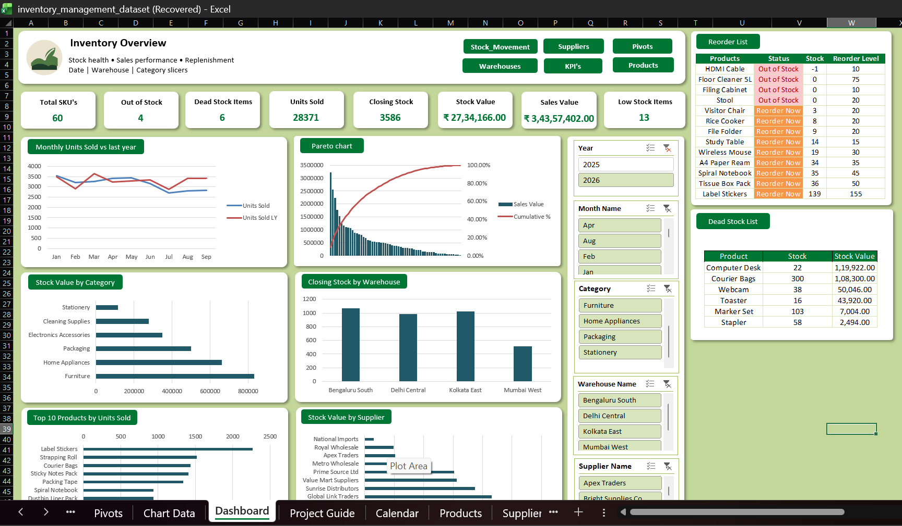

# Inventory Management & Stock Analysis Dashboard (Excel)

## Summary
An interactive Excel dashboard that tracks stock health, sales performance and replenishment needs for a multi-warehouse business. It uses 60 products, 10 suppliers and 4 warehouses, built on about 12,400 stock movements from Jan 2025 to Sep 2026. The raw data was cleaned in Power Query and modelled with relationships and DAX measures. The dashboard is controlled by slicers for Year, Month, Warehouse, Category and Supplier.

## Key Insights
- Total stock stands at **3,586 units** worth about **₹27.3 lakh**. Furniture and Home Appliances hold the largest share of stock value.
- **13 products** are below their reorder level, and 4 of them are completely out of stock.
- **6 products** have had no sales in 90 days. Their stock is worth about **₹3.3 lakh**, so ordering them again should stop.
- ABC analysis: about **18 of 60 products (30%)** produce roughly 70% of sales (Class A).
- Monthly sales stayed between about **2,700 and 3,600 units**, with no strong trend.

## What the Dashboard Includes
- 8 KPI cards: Total SKUs, Closing Stock, Stock Value, Units Sold, Sales Value, Low Stock Items, Out of Stock Items, Dead Stock Items
- Monthly Units Sold vs last year
- Pareto chart (ABC analysis)
- Stock Value by Category and by Supplier
- Closing Stock by Warehouse
- Top 10 Products by Units Sold
- Reorder alert list and dead stock list

## Data Cleaning (Power Query)
- Removed 40 duplicate transactions
- Fixed inconsistent text (spaces, upper/lower case) in Product ID and Movement Type
- Converted text dates to real dates
- Removed 10 rows with missing quantity. This left one product (HDMI Cable) at -1 stock, which is flagged as a data quality issue.

## Data Model & DAX
- Star-schema model with 5 related tables: Calendar, Products, Suppliers, Warehouses and Stock_Movements
- DAX measures for closing stock (running balance), stock value, units sold, month-over-month and year-over-year comparison, stock status, days of cover and dead stock

## Tools & Techniques
Power Query, Data Model and relationships, DAX measures, Pivot Tables and Pivot Charts, Slicers, Pareto and ABC analysis, XLOOKUP, conditional formatting, linked pictures

## Limitations
- The reorder level is set per product, not per warehouse. The Low Stock and Out of Stock cards are most accurate without a warehouse filter.
- The reorder and dead stock lists are not connected to the Year, Month and Warehouse slicers, so they always show the current position.

## Files
- `Inventory_Dashboard.xlsx`: the full workbook
- `Dashboard.png`: dashboard screenshot

> Note: The dataset is fictional and created for practice.
