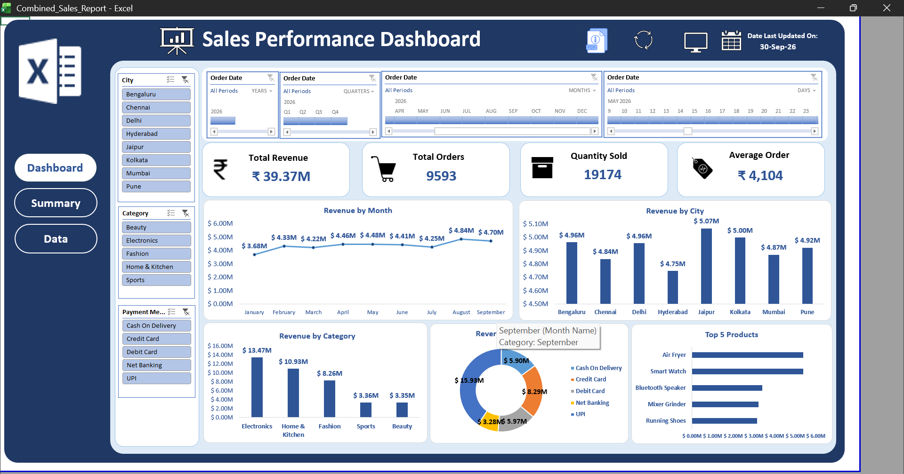

# Monthly Sales Report Automation (Excel: Power Query + VBA)

## Summary
An automated sales reporting workflow in Excel. Monthly sales exports (CSV files) are dropped into a folder. Power Query combines and cleans them into one table, the dashboard updates with a click on the refresh icon, and another icon exports a dated PDF report. Adding a new month needs no manual copying, cleaning or formatting.

The project uses 10 monthly files (Jan to Oct 2026, over 10,000 orders). The raw files have problems like those in real exports, which the query fixes on every refresh.

## How It Works
1. **Drop** a new monthly CSV into the sales_reports folder.
2. **Refresh** with the refresh icon. Power Query reads every file, cleans it and updates the dashboard.
3. **Export** the dashboard as a one-page PDF with the PDF icon.

## Key Insights
- Total revenue is about **₹44.1M**, with an average order value of about **₹4,100**.
- Monthly revenue grew from about **₹3.7M in January to about ₹4.7M in October**.
- Revenue is spread evenly across the 8 cities, between about ₹5.3M and ₹5.6M each.

## Data Problems Fixed Automatically (Power Query)
- Combined all CSV files with a custom column that reads each file and removes the 2 title rows above the header
- Ignored non-CSV files in the folder
- Removed the TOTAL row at the bottom of every file
- Removed duplicate orders (by Order ID)
- Cleaned Unit Price stored as text with a ₹ symbol and commas
- Replaced blank discounts with 0
- Standardised spacing and upper/lower case in City, Category and Payment Method, and merged inconsistent names for the same value (e.g. misspelled categories)
- Added Revenue, Year and Month columns

## Automation (VBA)
- **Refresh macro:** refreshes all queries and pivot tables and updates the "last updated" date
- **Full-screen macro:** toggles a clean full-screen view of the dashboard
- **PDF export macro:** refreshes the data and saves the dashboard as a one-page landscape PDF with a date-stamped file name

## Dashboard
KPI cards (Total Revenue, Total Orders, Quantity Sold, Average Order), Revenue by Month, Revenue by City, and more. Filter with slicers for City and Category, and timeline slicers for Year, Quarter, Month and Day.

## Tools & Techniques
Power Query (From Folder, custom columns, data cleaning), Pivot Tables and Charts, Slicers and Timelines, VBA macros, PDF export, dashboard design

## How to Use
1. Download the files and keep the sales_reports folder on your computer.
2. In Power Query, update the folder path in the first step (**Source**) to match your location.
3. Open the .xlsm file and click **Enable Content**.
4. Add a new CSV to the folder and click the refresh icon.

Requires Excel on Windows (macros).

## Files
- `Combined_Sales_Report.xlsm`: the workbook with dashboard, queries and macros
- `sales_reports/`: sample monthly CSV files
- `ReportAutomation.bas`: macro code
- `Sample_Report.pdf`: example of the exported report
- `Dashboard.png`: dashboard screenshot

> Note: The dataset is fictional and created for practice.
